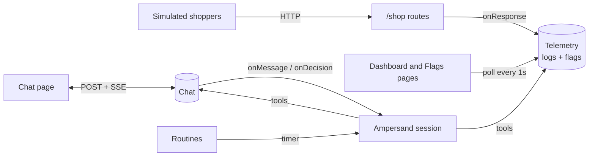
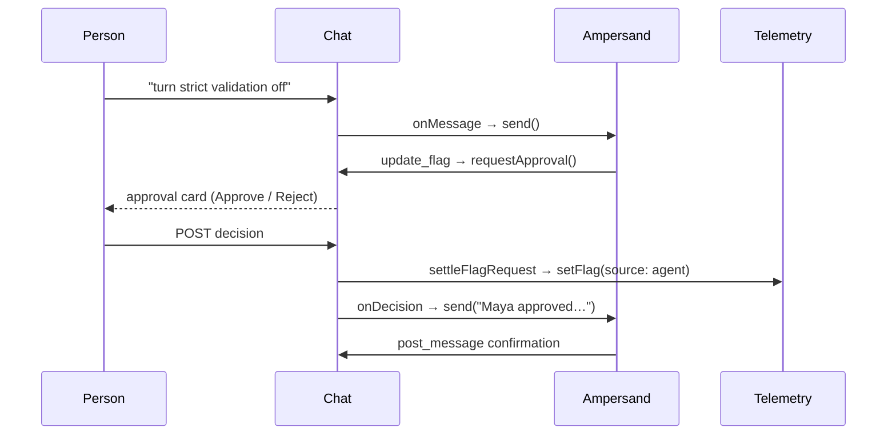

# Incident Pal

Incident Pal is a demo of an AI teammate that helps during a production incident. It has a small shop called Storeify that serves real HTTP traffic, a Slack-like chat, and Ampersand, an agent that reads the chat, logs, and feature flags and helps people find and fix the problem.

A live copy runs at [incident-pal.onrender.com](https://incident-pal.onrender.com).

## Repository layout

| Directory | Component | Contents |
| --- | --- | --- |
| `payments/` | Storeify shop | Shop routes and simulated shoppers (`checkout.ts`), request logs and feature flags (`telemetry.ts`), the dashboard and flags pages |
| `messenger/` | Slack-like chat | The `Chat` model (`chat.ts`), seeded channels and messages (`seed.ts`), one file per HTTP route (`routes/`), the chat page and avatars |
| `ampersand/` | Ampersand agent | The session class (`agent.ts`), routines (`routines.ts`), the thinking indicator, typed errors, system prompt, agent tools, and the transcript page |
| `shared/` | Shared | Demo shopper fixtures, browser UI helpers, styles, fonts and icons |

`server.ts` creates the single Fastify app that connects the three components. Each page is a React app under its component's `client/` directory, and `npm run build` bundles them with esbuild. All state is held in memory and resets on restart.

## How it works



### Ampersand

`Ampersand` (`ampersand/agent.ts`) owns one remote session and feeds it inputs one turn at a time. Chat messages, approval decisions, and routine runs all arrive through `send()`. Inputs that arrive during a turn wait in the queue and are sent together as the next turn.

```txt
send(input)
  queue.push(input)
  run()
    if already running → return            # the running loop picks it up
    while queue is not empty
      inputs = queue.splice(0)             # batch everything waiting
      turn(inputs)
        no session → sessions.create(stream)   # sessionId read from the first event
        session    → sessions.stream(...)       # idempotency key: first input's ID
          SDK calls runTool(name, args) for each tool call
            observers.toolStarted
            tools.execute → result, or { error } on throw
            observers.toolFinished
      on failure → recover()               # keep the session if idle, otherwise delete it
      observers.turnEnded
```

Two `TurnObserver`s watch each turn without the agent knowing what they do:

| Observer | Reacts to | Effect |
| --- | --- | --- |
| `ThinkingIndicator` | the first tool call, then `post_message` or `pass` | Shows and clears "Ampersand is thinking…" in the channels the turn is answering |
| `Routines` | `turnEnded` | Clears the pending run, so the next tick for that routine can fire |

A flag change takes two trips through the agent, because a person has to approve it in between:



The flag is changed by `settleFlagRequest` in the server, not by the model, so approving applies exactly the action stored on the card.

### Chat

The server's `Chat` (`messenger/chat.ts`) holds channels, participants, and the last 100 messages per channel. Every change is broadcast to each open browser as a server-sent event. Browsers write with plain POSTs and read only from the stream.

```txt
messenger/
├── chat.ts            # Chat model: history, approvals, thinking state, SSE broadcast
├── routes/            # one file per HTTP route; auth.ts checks the participant token
│   ├── events.ts      # GET /events: snapshot, then live events, plus a 15s heartbeat
│   ├── create_message.ts   # dedupes by nonce, then calls onMessage → Ampersand
│   └── decide_approval.ts  # calls onDecision → settle flag + tell Ampersand
└── client/
    ├── chat.tsx       # page, useChatStream reducer, ApprovalCard
    ├── use_chat_page.ts    # session, dialogs, and send state
    ├── use_unread.ts       # per-channel read times in localStorage
    └── actions/       # one fetch wrapper per POST
```

| SSE event | Sent when | Client effect |
| --- | --- | --- |
| `snapshot` | a browser connects | Replaces all channels, messages, and thinking state |
| `channel` | a channel is created | Adds it to the sidebar |
| `message` | anyone (or Ampersand) posts | Appends to the channel |
| `message_updated` | an approval is decided | Replaces the message so the card shows the outcome |
| `thinking` | a turn starts or stops working on a channel | Shows or hides the indicator |

```ts
<ChatPage> (messenger/client/chat.tsx)
  useChatStream()        // EventSource → chatReducer
  useChatPage()          // session, dialogs, sending
  useUnread()
  <History>
    <MessageRow>
      <ApprovalCard>     // Approve / Reject for named approvers
  <Composer>             // per-channel drafts
  <JoinDialog> <ChannelDialog>
```

### Telemetry dashboard

`Telemetry` (`payments/telemetry.ts`) is the single source of truth for request logs and flags. The shop's `onResponse` hook records every `/shop` request, and the shop reads flags on each request, so a change applies immediately.

```txt
shopper loop (×4, payments/checkout.ts)
  GET  /shop/products
  POST /shop/cart       { productId, currency }
  POST /shop/checkout   { cartId, currency on odd runs only }
    if strict_payment_validation and payment currency ≠ cart currency
      → 502 PAYMENT_PROVIDER_REJECTED
  onResponse → telemetry.record()   # level = error if status ≥ 400
```

Because only odd runs send a currency, turning on **Strict payment validation** makes some checkouts fail with 502.

The dashboard polls `GET /api/dashboard` every second. `telemetry.health()` counts the logs from the last 2 minutes into 24 five-second buckets and returns the flag changes in that window as markers.

```ts
<DashboardPage> (payments/client/app.tsx)
  usePolled('/api/dashboard[?level=error]')
  <VolumeChart>        // stacked info/error bars, dashed line per flag change
  <LogRow>             // expanding a row freezes the list until "Resume live logs"
<FlagsPage> (payments/client/flags.tsx)
  usePolled('/api/flags')
  toggle → POST /api/flags   // recorded with source: human
```

Each flag change is recorded with its source: `human` for a change made on the Flags page, and `agent` plus `approvedBy` for an approved Ampersand request. The Flags page history shows both.

## Run locally

Use Node.js 22 or newer. Set `AMPERSAND_API_KEY` in `.env` or the shell before starting the server.

```sh
npm ci
npm start
```

Open [the dashboard](http://127.0.0.1:3000). Set `PORT` to change the port. The server binds to loopback by default. Run `npm run check` for a type check.

## Dashboard and feature flags

Four simulated shoppers send real HTTP requests to `GET /shop/products`, `POST /shop/cart`, and `POST /shop/checkout`.

- **Dashboard** charts log volume over the last 2 minutes in 5-second buckets, stacking errors over successful requests and marking flag changes. Below it, **Request logs** lists recent requests, filterable to errors, with each request's ID, flow ID, and duration.
- **Feature flags** shows each flag and its change history, including changes Ampersand made and who approved them.

| Flag | Default | Effect when on |
| --- | --- | --- |
| Order receipts | On | Adds a receipt ID to the checkout response. |
| Cart item details | Off | Adds the product and quantity to the cart response. |
| Strict payment validation | Off | Checks the payment currency against the cart quote. Some payments start returning HTTP 502. |

Flags apply immediately, including to requests already in progress. The server keeps the most recent 10,000 request logs.

## Chat

Open [Chat](http://127.0.0.1:3000/chat) in two browsers and join with different display names. Messages, new channels, and Ampersand's "thinking…" indicator appear in every connected browser as they happen, and channels show unread counts.

The workspace starts with `#incident-response` for technical discussion, `#global-incident-status` for stakeholder updates, and `#all-water-cooler`, `#eng-core-payments`, `#eng-growth`, and `#eng-fulfillment`, each with example messages. Choose the plus next to the channel list to create a channel. The server keeps the latest 100 messages per channel.

For a demo with people on the same trusted network, run `HOST=0.0.0.0 npm start` and share `http://<your-local-ip>:3000/chat`. Display names are per browser tab. Anyone who can reach the demo can join its channels and use the dashboard.

## Ampersand

The app runs one [Ampersand](https://ampersand.humansand.ai/docs/GUIDES.html) agent on `ampersand-v0.1`. Its session is created when the first chat message arrives and receives every human message across all channels, one turn at a time. Messages that arrive during a turn are sent together in the next one. If a turn fails and the session can't continue, the server deletes it and the next message creates a new one. The session is deleted on shutdown.

The **Ampersand** page shows the session transcript, its system prompt, token usage, and estimated cost.

### Try it

1. Open **Chat** and join with a display name.
2. Turn on **Strict payment validation** in **Feature flags** and watch errors appear on the **Dashboard**.
3. Ask Ampersand to investigate in `#incident-response`. It reads the chat, logs, and flag history to find the cause.
4. Ask it to turn the flag off. It posts an approval request with **Approve** and **Reject** buttons, and the flag changes only if one of the named approvers approves.
5. Ask it to keep an eye on checkout errors for the next half hour. It schedules a routine and checks in on its own.

Ampersand stays quiet on messages it can't help with by calling `pass`.

### Routines

Ampersand can schedule routines that wake it on a fixed interval, from every minute to once a day. Each run arrives as a message with the instructions it wrote for itself. Routines post a note in their channel when they start, stop, or expire. They expire after 4 hours by default and 24 hours at most, at most five run at once, and a run is skipped while the previous one is still in progress.

### Tools

Ampersand calls these tools through its session. The OpenAI SDK runs each call and submits the result.

| Tool | What it does | Example input |
| --- | --- | --- |
| `list_channels` | Lists chat channels | `{}` |
| `read_channel` | Reads a channel, newest first | `{"channel":"incident-response","limit":10}` |
| `post_message` | Posts in a channel | `{"channel":"global-incident-status","text":"Payments are recovering."}` |
| `query_logs` | Finds recent requests, newest first | `{"level":"error","route":"/shop/checkout","limit":10}` |
| `tail_logs` | Reads new requests in order | `{"level":"error"}`, then `{"level":"error","after":42}` |
| `get_flags` | Lists flags and their current values | `{}` |
| `get_flag_history` | Lists changes to flags | `{"flag":"strict_payment_validation"}` |
| `update_flag` | Asks named people to approve a flag change | `{"channel":"incident-response","flag":"strict_payment_validation","enabled":false,"reason":"…","approvers":["…"]}` |
| `schedule_routine` | Wakes Ampersand on an interval | `{"channel":"incident-response","instructions":"Check checkout errors.","every_minutes":5}` |
| `list_routines` | Lists active routines | `{}` |
| `cancel_routine` | Stops a routine | `{"routine_id":"routine-1"}` |
| `pass` | Ends the turn without posting | `{}` |

For `read_channel` and `query_logs`, pass `nextBefore` as `before` for older results. For `tail_logs`, poll with the returned cursor as `after` and the same filters. `missed` indicates that some entries aged out.
