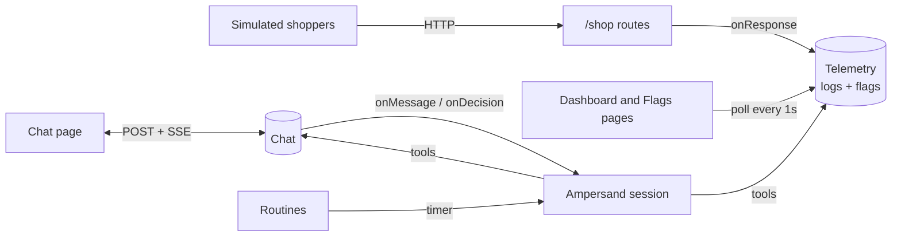
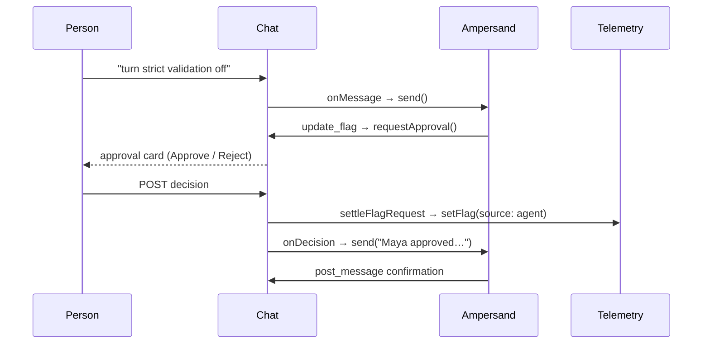

# Incident Pal

Incident Pal is a demo of an AI teammate that helps during a production incident. It has a small shop called Storeify that serves real HTTP traffic, a Slack-like chat, and Ampersand, an agent that reads the chat, logs, and feature flags and helps people find and fix the problem.

A live copy runs at [incident-pal.onrender.com](https://incident-pal.onrender.com).

## Repository layout

| Directory | Component | Contents |
| --- | --- | --- |
| `payments/` | Storeify shop | Shop routes and simulated shoppers (`checkout.ts`), request logs and feature flags (`telemetry.ts`), the dashboard and flags pages |
| `messenger/` | Slack-like chat | The `Chat` model (`chat.ts`), seeded channels and messages (`seed.ts`), one file per HTTP route (`routes/`), the chat page and avatars |
| `ampersand/` | Ampersand agent | The session class (`agent.ts`), routines (`routines.ts`), the thinking indicator, typed errors, system prompt, agent tools, and the transcript page |
| `shared/` | Shared | Demo shopper fixtures, browser UI helpers, styles, fonts and icons |

`server.ts` creates the single Fastify app that connects the three components. Each page is a React app under its component's `client/` directory, and `npm run build` bundles them with esbuild. All state is held in memory and resets on restart.

## How it works



### Ampersand

`Ampersand` (`ampersand/agent.ts`) owns one remote session and feeds it inputs one turn at a time. Chat messages, approval decisions, and routine runs all arrive through `send()`. Inputs that arrive during a turn wait in the queue and are sent together as the next turn.

```txt
send(input)
  queue.push(input)
  run()
    if already running → return            # the running loop picks it up
    while queue is not empty
      inputs = queue.splice(0)             # batch everything waiting
      turn(inputs)
        no session → sessions.create(stream)   # sessionId read from the first event
        session    → sessions.stream(...)       # idempotency key: first input's ID
          SDK calls runTool(name, args) for each tool call
            observers.toolStarted
            tools.execute → result, or { error } on throw
            observers.toolFinished
      on failure → recover()               # keep the session if idle, otherwise delete it
      observers.turnEnded
```

Two `TurnObserver`s watch each turn without the agent knowing what they do:

| Observer | Reacts to | Effect |
| --- | --- | --- |
| `ThinkingIndicator` | the first tool call, then `post_message` or `pass` | Shows and clears "Ampersand is thinking…" in the channels the turn is answering |
| `Routines` | `turnEnded` | Clears the pending run, so the next tick for that routine can fire |

A flag change takes two trips through the agent, because a person has to approve it in between:



The flag is changed by `settleFlagRequest` in the server, not by the model, so approving applies exactly the action stored on the card.

### Chat

The server's `Chat` (`messenger/chat.ts`) holds channels, participants, and the last 100 messages per channel. Every change is broadcast to each open browser as a server-sent event. Browsers write with plain POSTs and read only from the stream.

```txt
messenger/
├── chat.ts            # Chat model: history, approvals, thinking state, SSE broadcast
├── routes/            # one file per HTTP route; auth.ts checks the participant token
│   ├── events.ts      # GET /events: snapshot, then live events, plus a 15s heartbeat
│   ├── create_message.ts   # dedupes by nonce, then calls onMessage → Ampersand
│   └── decide_approval.ts  # calls onDecision → settle flag + tell Ampersand
└── client/
    ├── chat.tsx       # page, useChatStream reducer, ApprovalCard
    ├── use_chat_page.ts    # session, dialogs, and send state
    ├── use_unread.ts       # per-channel read times in localStorage
    └── actions/       # one fetch wrapper per POST
```

| SSE event | Sent when | Client effect |
| --- | --- | --- |
| `snapshot` | a browser connects | Replaces all channels, messages, and thinking state |
| `channel` | a channel is created | Adds it to the sidebar |
| `message` | anyone (or Ampersand) posts | Appends to the channel |
| `message_updated` | an approval is decided | Replaces the message so the card shows the outcome |
| `thinking` | a turn starts or stops working on a channel | Shows or hides the indicator |

```ts
<ChatPage> (messenger/client/chat.tsx)
  useChatStream()        // EventSource → chatReducer
  useChatPage()          // session, dialogs, sending
  useUnread()
  <History>
    <MessageRow>
      <ApprovalCard>     // Approve / Reject for named approvers
  <Composer>             // per-channel drafts
  <JoinDialog> <ChannelDialog>
```

### Telemetry dashboard

`Telemetry` (`payments/telemetry.ts`) is the single source of truth for request logs and flags. The shop's `onResponse` hook records every `/shop` request, and the shop reads flags on each request, so a change applies immediately.

```txt
shopper loop (×4, payments/checkout.ts)
  GET  /shop/products
  POST /shop/cart       { productId, currency }
  POST /shop/checkout   { cartId, currency on odd runs only }
    if strict_payment_validation and payment currency ≠ cart currency
      → 502 PAYMENT_PROVIDER_REJECTED
  onResponse → telemetry.record()   # level = error if status ≥ 400
```

Because only odd runs send a currency, turning on **Strict payment validation** makes some checkouts fail with 502.

The dashboard polls `GET /api/dashboard` every second. `telemetry.health()` counts the logs from the last 2 minutes into 24 five-second buckets and returns the flag changes in that window as markers.

```ts
<DashboardPage> (payments/client/app.tsx)
  usePolled('/api/dashboard[?level=error]')
  <VolumeChart>        // stacked info/error bars, dashed line per flag change
  <LogRow>             // expanding a row freezes the list until "Resume live logs"
<FlagsPage> (payments/client/flags.tsx)
  usePolled('/api/flags')
  toggle → POST /api/flags   // recorded with source: human
```

Each flag change is recorded with its source: `human` for a change made on the Flags page, and `agent` plus `approvedBy` for an approved Ampersand request. The Flags page history shows both.

## Run locally

Use Node.js 22 or newer. Set `AMPERSAND_API_KEY` in `.env` or the shell before starting the server.

```sh
npm ci
npm start
```

Open [the dashboard](http://127.0.0.1:3000). Set `PORT` to change the port. The server binds to loopback by default. Run `npm run check` for a type check.

## Demo

[Watch the Storeify demo video](docs/storeify.mp4) (MP4, 87 MB).
